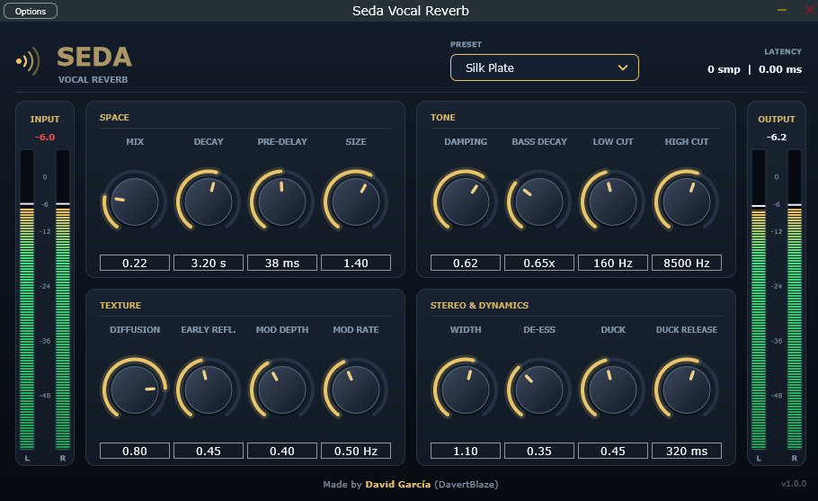
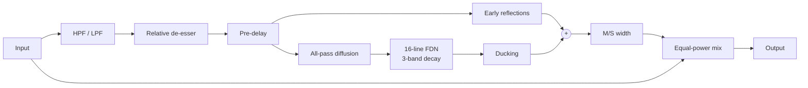

# Seda — Vocal Reverb

## Download

Get the latest Windows build from the [Releases page](https://github.com/DavertGames/Seda-vocalreverb/releases/latest).

- **Standalone:** unzip and run `Seda Vocal Reverb.exe`
- **VST3:** copy the `.vst3` folder to `C:\Program Files\Common Files\VST3`

[](https://github.com/DavertGames/Seda-vocalreverb/actions/workflows/ci.yml)


A stereo reverb plugin designed specifically for vocals: dense and smooth tail, controlled low end, tamed sibilance, and a ducker that lets the reverb bloom in the gaps between phrases.

The DSP core is a **header-only, dependency-free C++17 library** (`Source/VocalReverbDSP.h`) wrapped in a JUCE plugin, with a standalone test harness that measures the reverb objectively.




## Features

- **16-line Feedback Delay Network** with a Householder feedback matrix and modulated, cubic-interpolated delay lines
- **Three-band decay control** per line (Jot-style absorption): independent low / mid / high RT60, so the tail stays silky instead of muddy
- **Vocal-oriented send chain:** low/high cut, relative de-esser (only reacts to HF-dominant material), pre-delay
- **Early reflections** (8 taps per channel with air absorption) and modulated all-pass input diffusion
- **Ducking:** the tail attenuates (up to ~30 dB) while the vocal is singing and recovers in the gaps
- Decorrelated stereo output (Hadamard rows) with M/S width control
- 5 factory presets, stereo input and output peak meters with peak-hold, latency readout
- Zero reported latency, ~2 % of one CPU core at 48 kHz

## Signal flow



## Measured results

The reverb is validated by `Tests/dsp_test.cpp` (no JUCE required) and checked on every push by CI.

| Test | Result |
|---|---|
| RT60 requested vs. measured (44.1 / 48 / 96 kHz) | within ±3 % |
| Decay by band at default settings | low and high bands decay faster than mids |
| Normalised echo density at 250 ms | ≈ 1.0 (Gaussian-diffuse) |
| Spectral roughness of the tail | ~5.6 dB (ideal diffuse field ≈ 5.6 dB; >7 dB would sound metallic) |
| L/R correlation of the tail (mono input) | ≈ 0 |
| Stability | random extreme parameter automation with full-scale noise: no NaN / Inf, tail decays to silence |
| De-esser | sibilant material −12 dB, voiced material unaffected |
| Memory safety | clean under AddressSanitizer and UBSan |

Run it yourself:

```bash
g++ -O2 -std=c++17 Tests/dsp_test.cpp -o dsp_test && ./dsp_test
```

## Build

Requirements: CMake ≥ 3.22, a C++17 compiler. JUCE is fetched automatically.

```bash
cmake -B build
cmake --build build --config Release
```

On Windows with Visual Studio: `cmake -B build -G "Visual Studio 17 2022"`, then open `build/Seda.sln`.
Use `-DSEDA_COPY_AFTER_BUILD=OFF` to skip copying the plugin to your system plugin folder.

Artifacts end up in `build/Seda_artefacts/Release/` (`VST3/`, `Standalone/`, and `AU/` on macOS).

## Project structure

```
Source/
  VocalReverbDSP.h     Header-only DSP core (no JUCE dependency)
  PluginProcessor.*    JUCE processor: parameters, presets, metering
  PluginEditor.h       UI: custom knobs, panels, level meters
Tests/
  dsp_test.cpp         Standalone measurement and stability harness
```

## Design notes

- **Why an FDN?** It gives a dense, controllable tail at low CPU cost, with decay set per line from a single RT60 value.
- **Why Householder?** It is an orthogonal feedback matrix applied in O(N) operations, so the loop is lossless by construction and stability reduces to keeping each line's gain below 1.
- **Why three-band decay?** Vocals get muddy fast; shortening the low-frequency RT60 and damping highs keeps the tail behind the voice.
- **Why a relative de-esser?** It compares high-band energy to total energy, so it behaves the same regardless of input level.
- **Parameter smoothing:** control-rate exponential smoothing plus per-sample linear ramps on delay lengths and gains, so automation does not click.

## How this project was built

_Write this section yourself, honestly and specifically: what you designed, what you tuned by ear, what you changed or learned, and which tools (including AI assistants) you used. Recruiters value clarity on your own contribution._

## Roadmap

- [ ] Tempo-synced pre-delay
- [ ] Freeze mode
- [ ] Additional reverb modes
- [ ] macOS / Linux CI builds

## License

This project uses [JUCE](https://juce.com), which is available under AGPLv3 or a commercial license. This repository is released under **AGPL-3.0** (see `LICENSE`). Check JUCE's current licensing terms before distributing binaries commercially.

## Author

Made by **David García (DavertBlaze)**
